# CNL Plataforma

[](https://github.com/augustocristian/cnsa-management-platform/actions/workflows/pages.yml)
[](https://augustocristian.github.io/cnsa-management-platform/)
[](https://augustocristian.github.io/cnsa-management-platform/)
[](.github/dependabot.yml)


**Complete management for a swimming club**: swimmers, groups, training sessions with set-by-set plans and PDF export, attendance, training loads, personal bests linked to swimsuits, season and pool planning, a calendar and club notes, in a PWA that works from your phone at the pool.

CNL Plataforma is built for **individual use**. There is no sign-in and no user account: each coach just _connects Google Drive_ (an authorization with the single `drive.file` permission; the app never learns who you are) and **their data lives in the `cnl` folder of their own Google Drive**, only so that it persists and follows them across devices. Drive is not a shared database: there is no sharing, no roles, no multi-user mode, no server and no database. Swimmers and groups are records you manage, not app users. The **demo mode** (sample data kept only in your browser) is offered only while the copy of the app has no Google Client ID configured. It was first built for Club Natacion Lugones; the club name, motto, logo and colours are configurable. The interface is available in Spanish, English and Italian.

**[Open the live app](https://augustocristian.github.io/cnsa-management-platform/)** (GitHub Pages)

| Desktop                                                                                                                                          | Mobile                                                                                                                   |
| ------------------------------------------------------------------------------------------------------------------------------------------------ | ------------------------------------------------------------------------------------------------------------------------ |
|  |  |

## Contents

- [How it works](#how-it-works)
- [Features](#features)
- [Data and privacy](#data-and-privacy)
- [Owner setup](#owner-setup)
- [Development](#development)
- [CI/CD and GitHub Pages](#cicd-and-github-pages)
- [Dependencies](#dependencies)
- [Project documentation](#project-documentation)

## How it works

All images are real captures of the app (English interface unless noted), generated by `npm run capturas` with demo data and a fixed clock (Wednesday 14 October 2026).

### 1. First run and demo

What a person sees depends on how the copy of the app is configured. With no Google Client ID the start screen says **Setup required** and offers **Try the demo** first, with the one-off owner setup below it. With a Client ID the only action is **Connect Google Drive**. After connecting, a two-step wizard creates the club (name and motto, then colours with a live preview and the time zone) and the club starts empty.

| Desktop                                                                                                                                                                                            | Mobile                                                                                                                               |
| -------------------------------------------------------------------------------------------------------------------------------------------------------------------------------------------------- | ------------------------------------------------------------------------------------------------------------------------------------ |
| 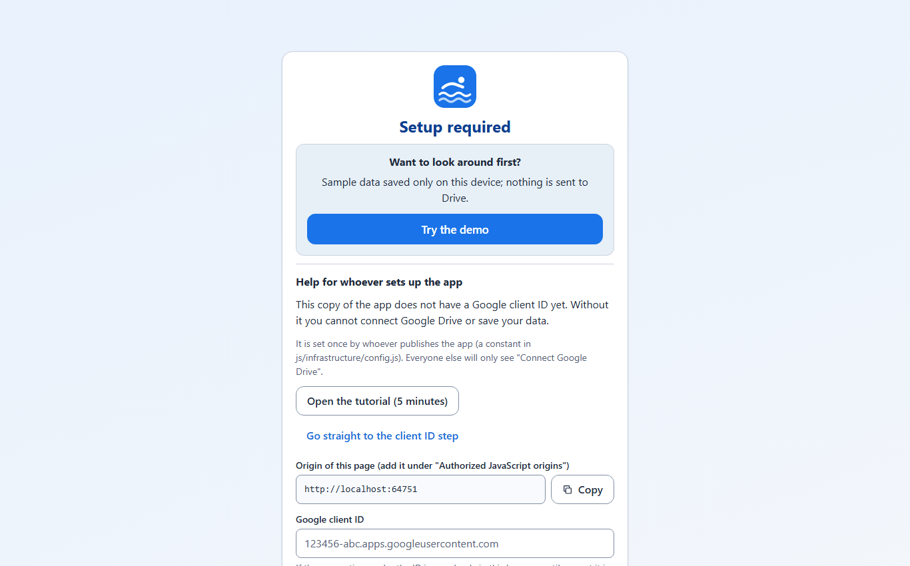                                            | 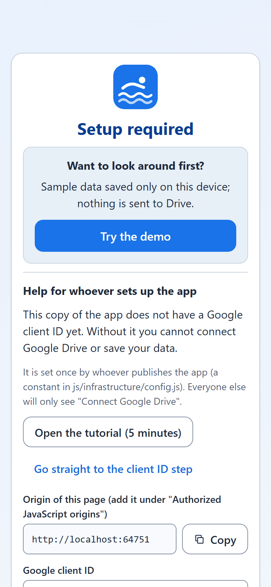 |
| 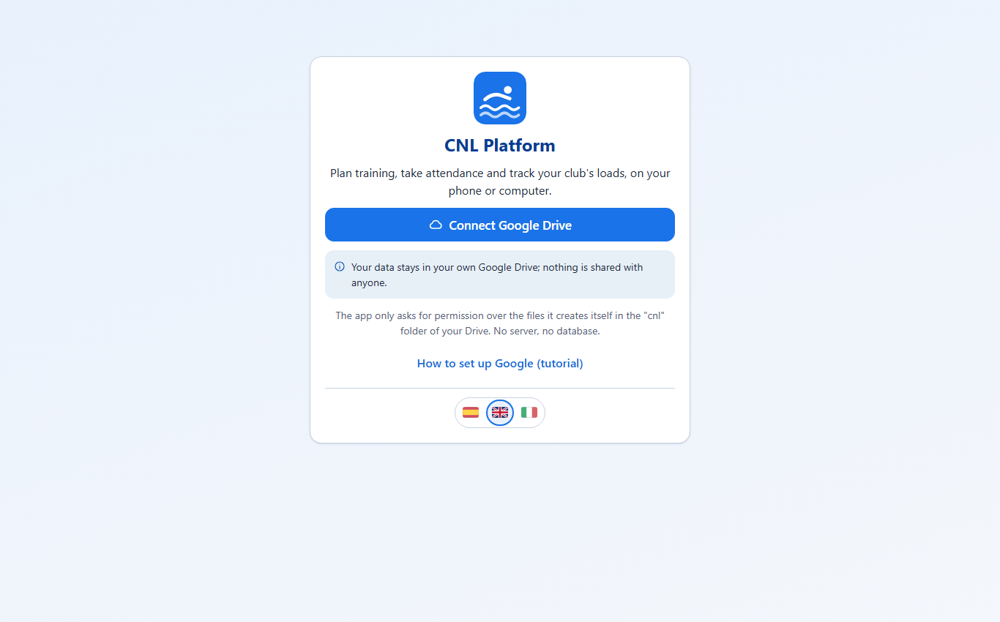                                          |                                                                                                                                      |
| 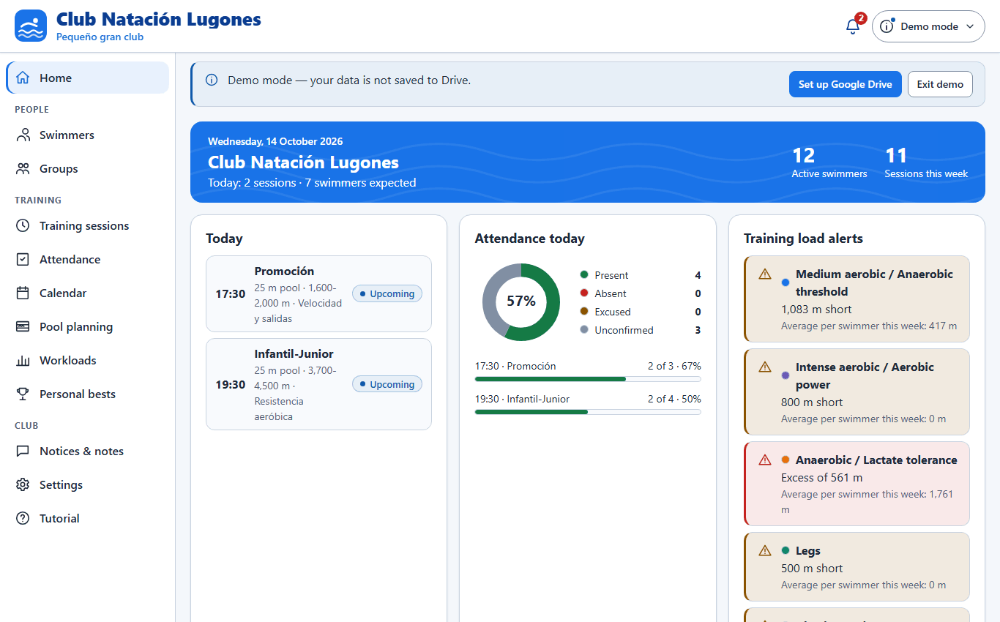 | 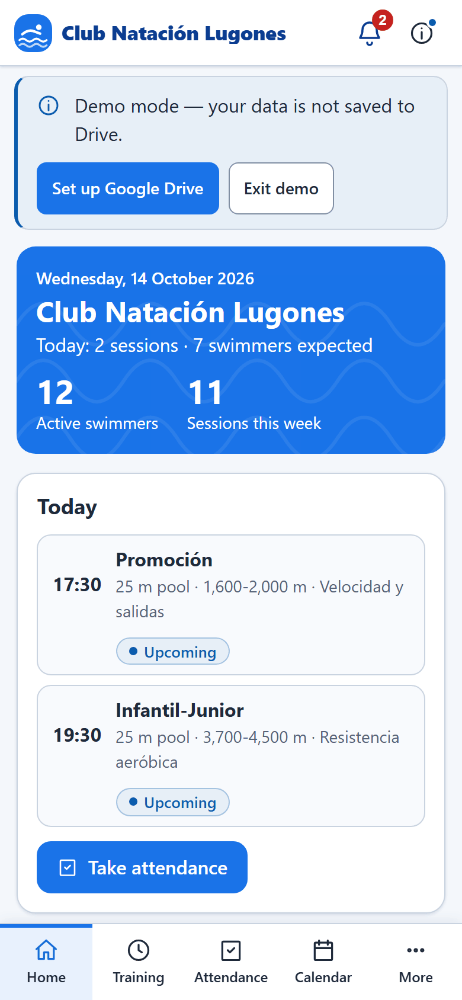                                            |
|                           |                                                                                                                                      |

The demo keeps sample data only in the browser, never touches Drive and is erased when you exit. Connecting Drive from the demo starts an empty real club.

### 2. A day at the pool: attendance and loads

Take attendance with one tap per swimmer (the summary stays visible while you scroll), log the metres swum per training content and compare them with the weekly targets.

| Desktop                                                                                                                                                                            | Mobile                                                                                                                                                |
| ---------------------------------------------------------------------------------------------------------------------------------------------------------------------------------- | ----------------------------------------------------------------------------------------------------------------------------------------------------- |
|  |                  |
|                                    | 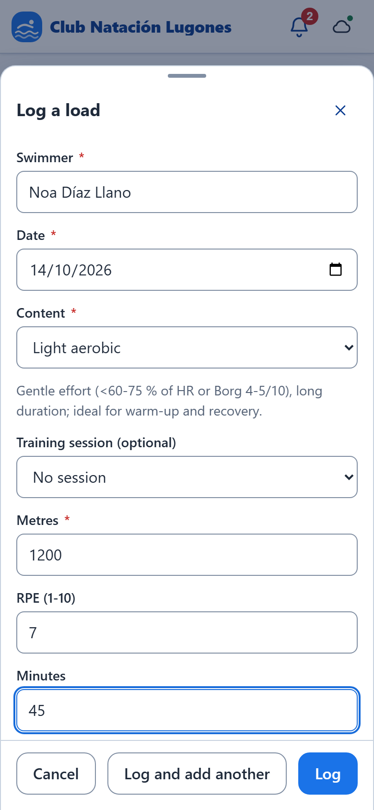 |
|              |                                                                                                                                                       |

### 3. The training plan editor and the PDF

The week of sessions lives in _Training_; each card has a menu with mark as done, edit, duplicate, download PDF and delete. **Open plan** builds the session set by set: each row takes two lines (reps, distance, exercise and a content chip with the metres, then interval, time, equipment, objective), the **summary** splits the metres by training content and by stroke, and a bottom bar keeps the total and the save button in reach.

| Desktop                                                                                                                                                          | Mobile                                                                                                                                 |
| ---------------------------------------------------------------------------------------------------------------------------------------------------------------- | -------------------------------------------------------------------------------------------------------------------------------------- |
|     |                                        |
| 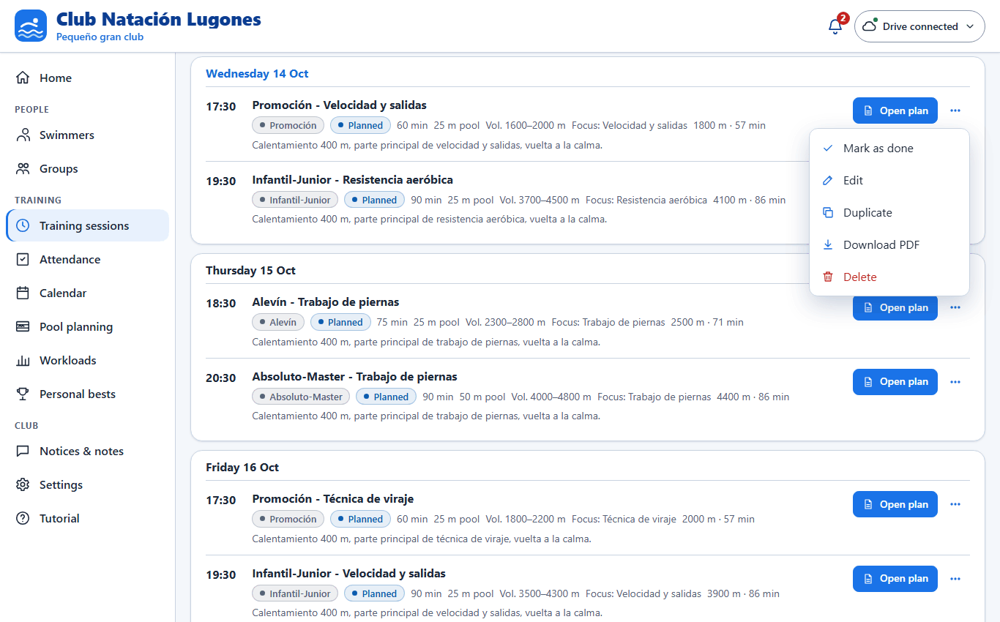         |                                                                                                                                        |
| 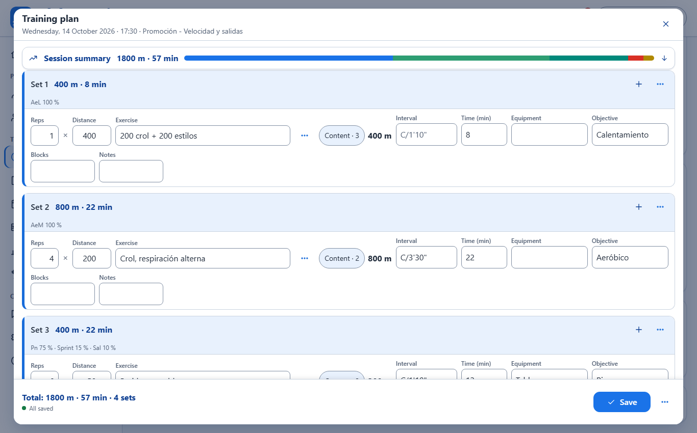 | 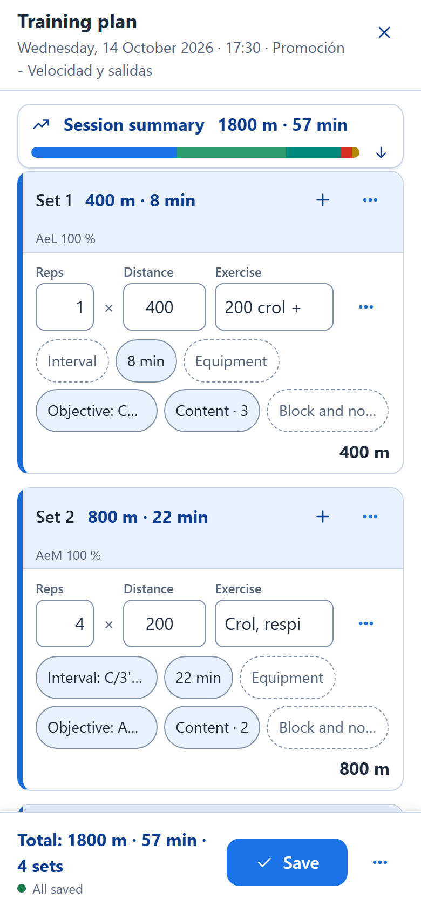 |
| 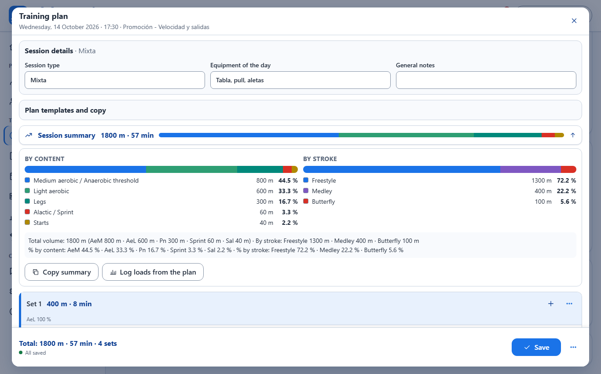                    |                                                                                                                                        |

The PDF (A4 landscape, one session or the whole week) can be downloaded, previewed, printed or saved to `cnl/entrenos/` in your Drive. This is page 1 of a PDF generated by the app:

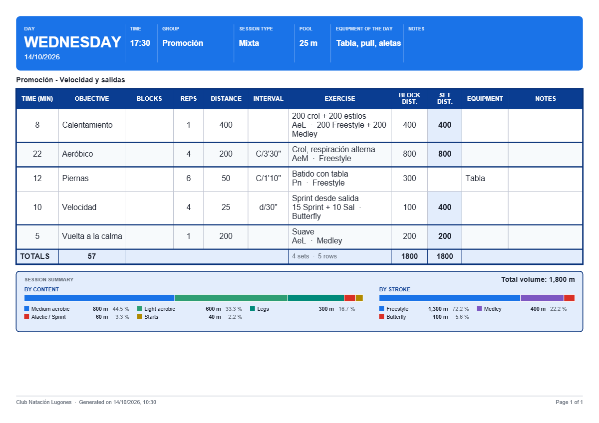

### 4. Season and pool planning

**Pool planning > Season** manages the whole season: phases (macrocycles), weeks (microcycles) with planned volume split by content, a comparison with what was really done, A/B/C competitions and other events, a progression chart, a timeline and adjustment suggestions.

| Desktop                                                                                                                                                                          | Mobile                                                                                        |
| -------------------------------------------------------------------------------------------------------------------------------------------------------------------------------- | --------------------------------------------------------------------------------------------- |
|                                                       |  |
|  |                                                                                               |
|                           |                                                                                               |
| 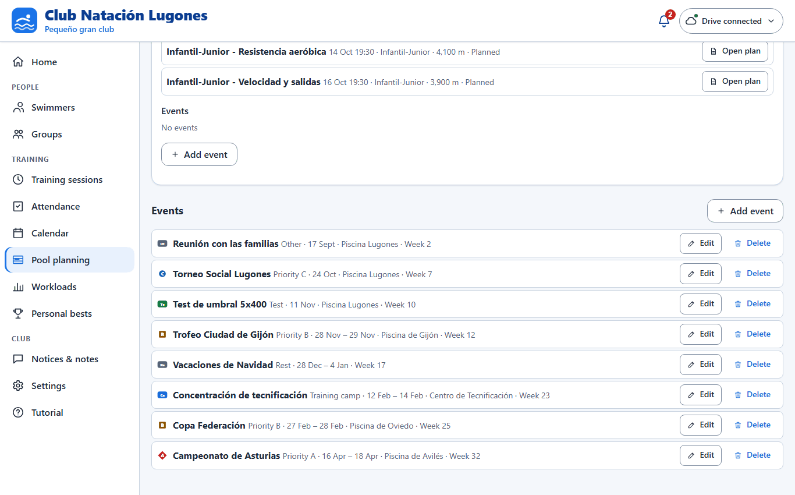                       |                                                                                               |

**Pool planning > Pool** organises the pool: lanes and schedule per day, courses assigned to lanes and hours (weekly or one-off) and a conflicts panel (lane, group, coach, schedule, capacity).


### 5. Calendar and export

Month, week and agenda views with a colour per group and filters by group and pool. Events are the sessions, the lane assignments and the season events. The **Export** menu downloads an `.ics` file (Apple, Outlook, Google), adds the calendar to your own or opens the export options, including optional Google Calendar sync.

| Desktop                                                                                                                                                   | Mobile                                                                                                      |
| --------------------------------------------------------------------------------------------------------------------------------------------------------- | ----------------------------------------------------------------------------------------------------------- |
|                     |  |
|                                                        |                                                                                                             |
|  |                                                                                                             |

### 6. Personal bests with swimsuits

A club catalogue of swimsuits (training suits and competition fast skins, with brand and model) can be attached to each time, and times can be filtered by swimmer, event, pool, suit type, brand and model. The second image shows an evolution chart of one swimmer in one event.

| Desktop                                                                                                                                                           | Mobile                                                                                                         |
| ----------------------------------------------------------------------------------------------------------------------------------------------------------------- | -------------------------------------------------------------------------------------------------------------- |
|               |  |
|           |                                                                                                                |
| 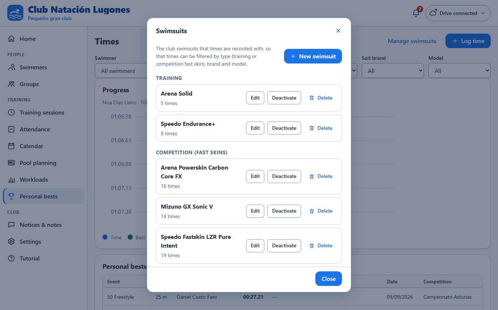 |                                                                                                                |

### 7. Swimmers, groups and notes

| Desktop                                                                                                                                                         |
| --------------------------------------------------------------------------------------------------------------------------------------------------------------- |
|                                         |
|                |
|  |
|                                                     |
|          |

### 8. Settings: categories, backup and GDPR

Club identity, the categories of the season (calculated from the birth year and sex, with a season change preview), where the data lives in Drive, a complete backup with optional encryption and restore, and the GDPR notes.

| Desktop                                                                                                                                                                         | Mobile                                                                                                                    |
| ------------------------------------------------------------------------------------------------------------------------------------------------------------------------------- | ------------------------------------------------------------------------------------------------------------------------- |
|                                                    |                                                                                                                           |
|  |                                                                                                                           |
|                                    | 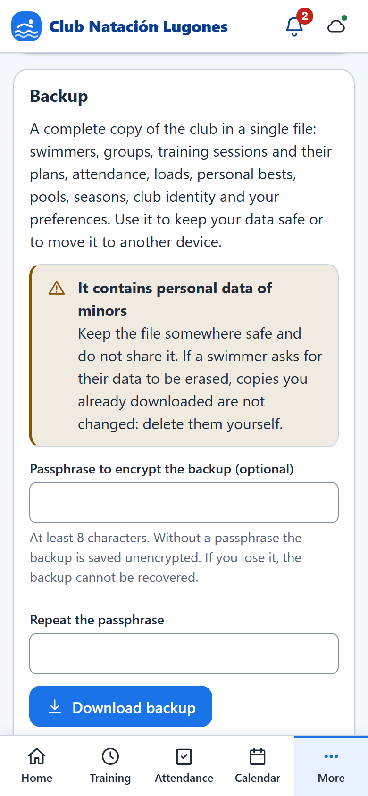 |
| 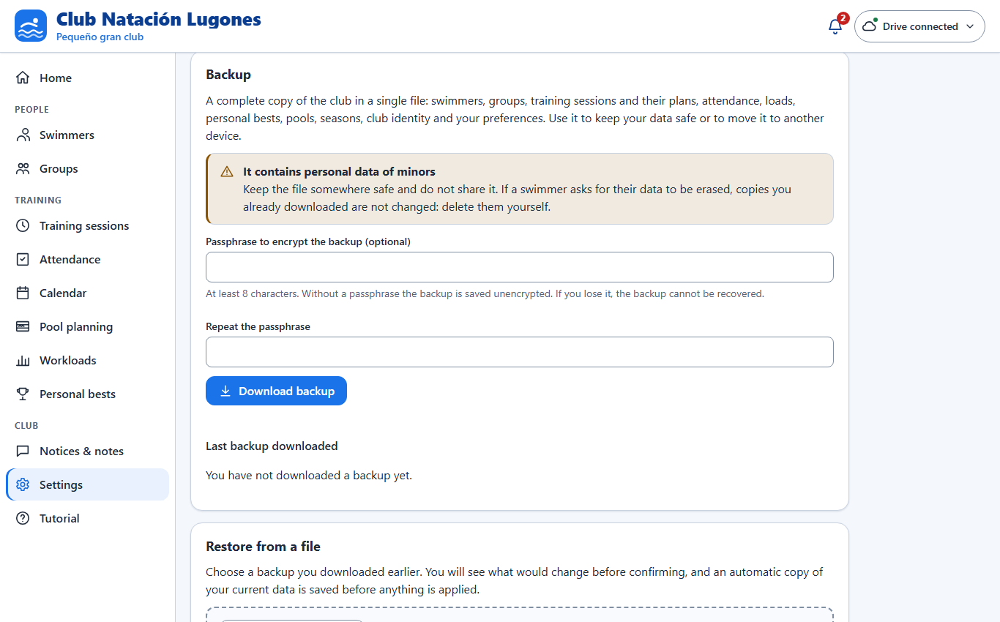                             |                                                                                                                           |
| 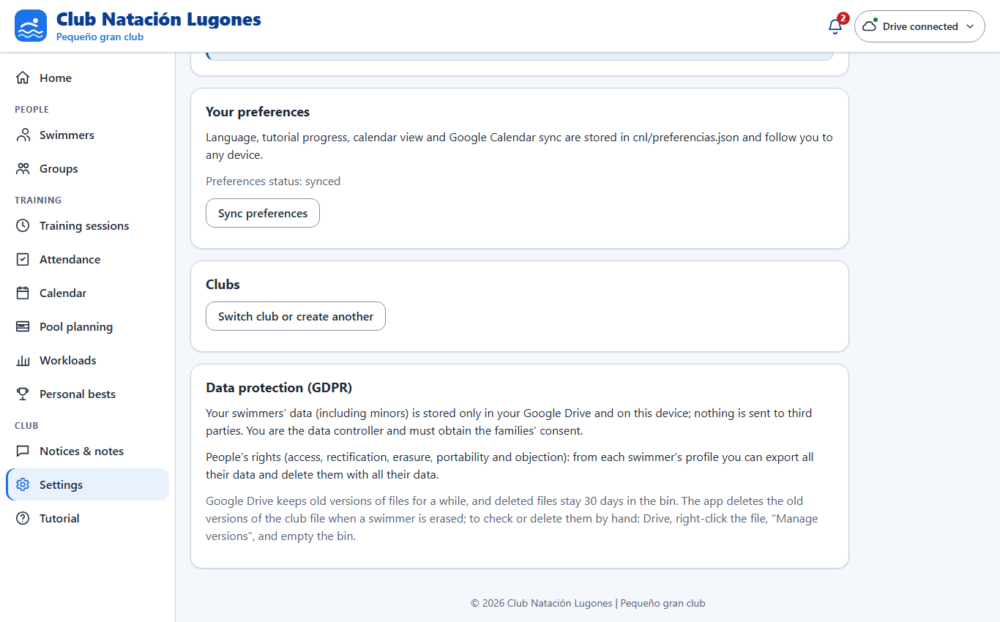                                       |                                                                                                                           |
|                                               |                                                                                                                           |

### 9. Mobile navigation, connection menu, languages and dark mode

On a phone the app has a bottom bar with four modules and a **More** sheet with the rest. The connection menu (top right) holds the Drive status, the language flags, the colour theme and **Disconnect Drive**.

| Desktop                                                                                                                                                   | Mobile                                                                                                                    |
| --------------------------------------------------------------------------------------------------------------------------------------------------------- | ------------------------------------------------------------------------------------------------------------------------- |
| 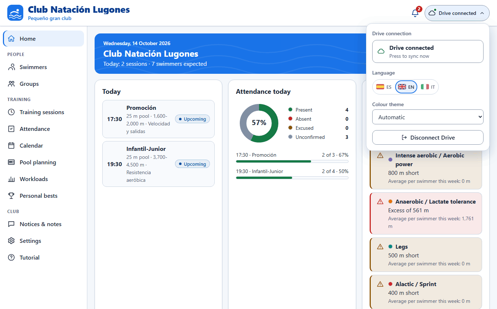 | 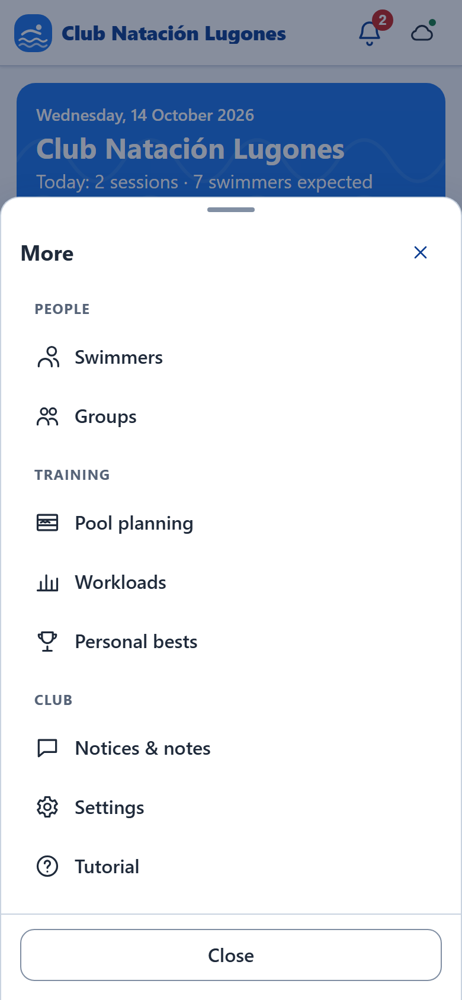 |
| 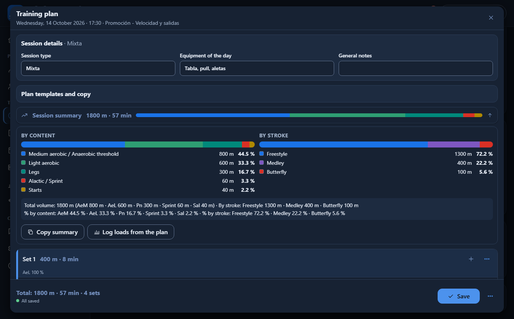                                                |                        |
| 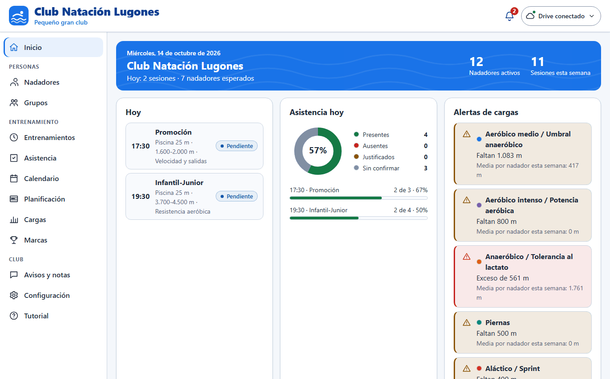                                                                   |                                                                                                                           |
|                                                   |                                                                                                                           |

## Features

| Module                | What it does                                                                                                                                                                                                                                                   |
| --------------------- | -------------------------------------------------------------------------------------------------------------------------------------------------------------------------------------------------------------------------------------------------------------- |
| **Home**              | Today's sessions and attendance, weekly loads against targets, alerts, quick actions, recent notes and the next season event; a First steps card on an empty club                                                                                              |
| **Swimmers / Groups** | Records you manage (never app users). Automatic category from birth year, sex and season (manual override and master licence), profile with attendance, loads and times, groups with coach                                                                     |
| **Training**          | Weekly sessions; detailed plan by sets with two-line rows, several contents and strokes per exercise (`4x100 Crol. 75 AeL-25 Tope`), templates, copy, summary by content and stroke that can be copied or registered as loads; A4 PDF of a session or the week |
| **Attendance**        | One-tap roll call with a sticky summary, excuses and notes, history and percentage per swimmer                                                                                                                                                                 |
| **Loads**             | Metres per training content (predefined catalogue plus your own), RPE, minutes, weekly minimum and maximum targets with alerts                                                                                                                                 |
| **Personal bests**    | Times mm:ss.cc, bests and evolution per event and pool, a swimsuit catalogue and filters by suit type, brand and model                                                                                                                                         |
| **Pool planning**     | Season (phases, weeks, planned against actual, events, chart, timeline, suggestions) and Pool (lanes, schedule, conflicts, suggested layout, printing)                                                                                                         |
| **Calendar**          | Month, week and agenda; filters; `.ics` export and optional Google Calendar sync                                                                                                                                                                               |
| **Notices & notes**   | Your own notes for the whole club or a group, saved in your Drive; copy the text to send it through your usual channel (the app sends nothing)                                                                                                                 |
| **Settings**          | Club identity, season categories, swimsuits, training contents, Drive locations, Excel export and import, full backup and restore, preferences, switching club, GDPR                                                                                           |
| **PWA**               | Installable, works offline from the local mirror once Drive was connected, light/dark/automatic theme, Spanish, English and Italian, WCAG 2.2 AA oriented design system (`docs/DESIGN.md`)                                                                     |

## Data and privacy

Everything lives in the **`cnl`** folder of the user's Google Drive with one permission, `drive.file` (the app only sees files it created; no `openid`, `email` or `profile`). The Google Sheets API is not used. Google Calendar sync is an optional, incremental scope requested only if you turn it on.

| Where                   | What it stores                                                                                                         |
| ----------------------- | ---------------------------------------------------------------------------------------------------------------------- |
| `cnl/<Club>.json`       | One file per club: identity, swimmers, groups, sessions, plans, attendance, loads, times, swimsuits, pools, seasons... |
| `cnl/preferencias.json` | Your preferences: language, theme, last club, tutorial progress, calendar view                                         |
| `cnl/entrenos/`         | Training PDFs saved from the app                                                                                       |
| `cnl/backups/`          | Rotating daily copy (last 14), a copy before every Excel import and before every restore (last 5 each)                 |
| `cnl/<Club>.xlsx`       | Optional Excel copy                                                                                                    |
| Browser                 | Only a cache and offline queue; never the source of truth. Tokens live in memory only                                  |

- **Backup format.** One lossless JSON file (`cnl-backup`, versioned, with a SHA-256 checksum), optionally encrypted on your device (AES-GCM, key derived with PBKDF2-SHA256). Restore previews the changes, offers Replace or Merge, always saves a safety copy first and refuses damaged or newer-version files.
- **GDPR tools.** Swimmers can be minors: export one swimmer's data, erase a swimmer and all their data (optionally from Drive too), and disconnecting Drive revokes the tokens and clears personal local data. The app sends nothing to third parties.
- **Sync.** Changes are saved with a debounce and merged field by field (logical clocks and tombstones) when the same person edits from several devices. The schema is versioned and a newer file opens read-only without losing unknown data.

The full layout and the data model are in [docs/ARCHITECTURE.md](docs/ARCHITECTURE.md).

## Owner setup

Whoever publishes a copy of the app creates a Google Client ID **once** (about 5 minutes) and puts it in `BUILTIN_CLIENT_ID` of `js/infrastructure/config.js`; everyone else only sees _Connect Google Drive_. For local testing the ID can be pasted on the _Setup required_ screen. Step by step: [docs/SETUP-GOOGLE.md](docs/SETUP-GOOGLE.md) (also built into the app as the Tutorial). The demo mode exists only while no Client ID is set.

## Development

```bash
npm install            # dependencies; copies SheetJS and jsPDF to vendor/ and writes their SRI hashes
npm run serve          # static server on http://localhost:4173 (or: node scripts/serve.mjs 8080)
npm run check          # syntax, generated service worker list and architecture rules
npm run format         # Prettier (format:check only verifies)
npm run lint           # ESLint (lint:fix applies safe fixes)
npm run verify         # check + format:check + lint: the gate CI runs and you run before every commit
npm run test:unit      # node:test + jsdom
npm run test:integration
npm run test:e2e       # Cucumber + Playwright, desktop then mobile (first time: npx playwright install chromium)
npm run capturas       # regenerates docs/screenshots (about 3 minutes)
```

**Tests pyramid.** Unit tests (`tests/unit`, domain, services, store, i18n, design statics), integration tests (`tests/integration`, views with the store on jsdom) and end-to-end scenarios in English Gherkin (`features/`, Playwright/Chromium on desktop and Pixel 5). Google is always simulated (`js/infrastructure/fakeGoogle.js`, enabled only on localhost with `localStorage['cnl:test']`), so no test calls real Google.

**Architecture layers.** `domain` (pure rules) <- `application` (services and ports) <- `infrastructure` (Drive, cache, Excel, PDF, fake Google) and `presentation` (shell, views, i18n); `composicion` is the only place that wires everything. The dependency rules are enforced by `npm run check:arch` (part of `npm run check`) with a ratchet baseline.

**Screenshots.** `scripts/capturas.mjs` starts the static server on a free port and drives Chromium with a fixed clock (14 October 2026, Europe/Madrid), reduced motion and no service worker. It captures the Drive-connected views through the simulated Google and the real start screens (setup required, connect Drive, demo mode) without the test adapter. A capture with console errors, 4xx/5xx responses or a loading view is rejected; large images are re-encoded as 256-colour PNG. Options: `--solo=<ids>`, `--dispositivo=escritorio|movil`, `--concurrencia=<n>`, `--salida=<dir>`.

## CI/CD and GitHub Pages

The workflow `.github/workflows/pages.yml` ("CI and deployment to GitHub Pages") runs on pushes to `main`, pull requests and manually: static validation (`npm run verify`, `npm audit`, vendor in sync), unit and integration tests, then end-to-end tests on desktop and mobile. **The deployment runs only after the tests pass**, only on `main`, and is followed by a smoke check of the published URL. Enable it once under _Settings > Pages > Source: GitHub Actions_. Only the runtime files (`index.html`, `manifest.webmanifest`, `sw.js`, `css`, `js`, `icons`, `vendor`) are published.

## Dependencies

Managed with npm and updated weekly by [Dependabot](.github/dependabot.yml) (npm and GitHub Actions).

| Package                                             | Use                                                   |
| --------------------------------------------------- | ----------------------------------------------------- |
| `@e965/xlsx` (SheetJS)                              | Excel export, import and backup (copied to `vendor/`) |
| `jspdf`, `jspdf-autotable`                          | Training PDFs (copied to `vendor/`, loaded lazily)    |
| `playwright`, `@cucumber/cucumber` (dev)            | End-to-end tests and the screenshot script            |
| `jsdom` (dev)                                       | Unit and integration tests                            |
| `pdfjs-dist` (dev)                                  | Draws page 1 of the generated PDF for the screenshot  |
| `prettier`, `eslint`, `@eslint/js`, `globals` (dev) | Formatting and linting                                |

## Project documentation

- [CLAUDE.md](CLAUDE.md): the working contract for Claude Code sessions (product model, stack, commands, architecture, testing, workflow).
- [docs/ARCHITECTURE.md](docs/ARCHITECTURE.md): layers, modules and data model.
- [docs/DESIGN.md](docs/DESIGN.md): design system, tokens, components, accessibility and security.
- [docs/SETUP-GOOGLE.md](docs/SETUP-GOOGLE.md): the one-off Google Client ID setup.
- [`.claude/`](.claude): agents and skills used to maintain the project (screenshots, features, releases, i18n, security).
